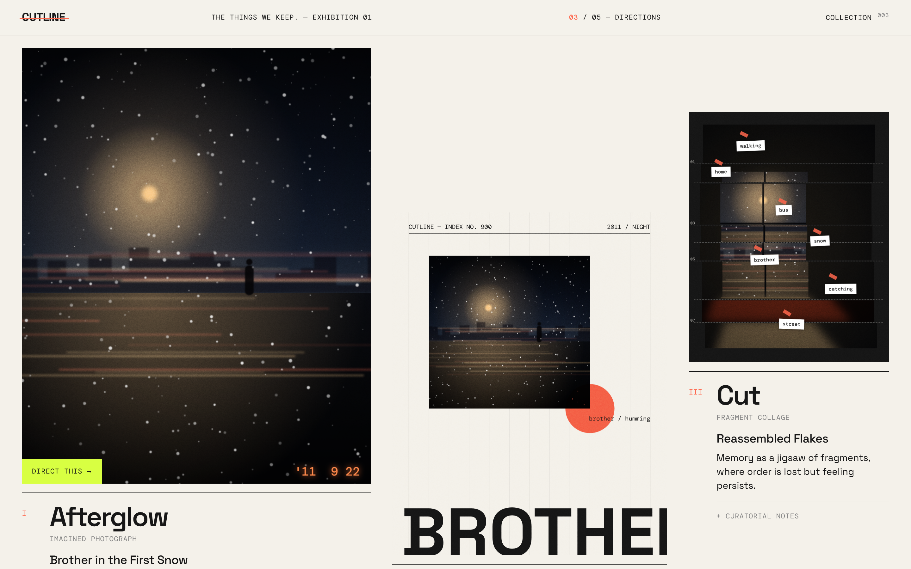
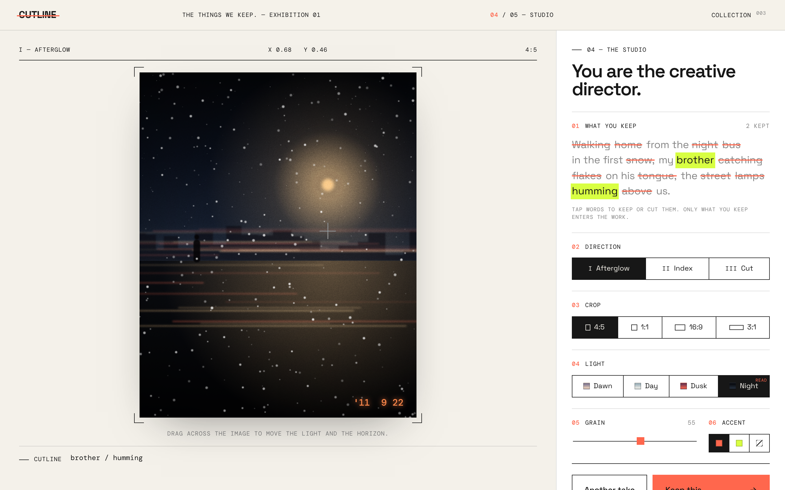
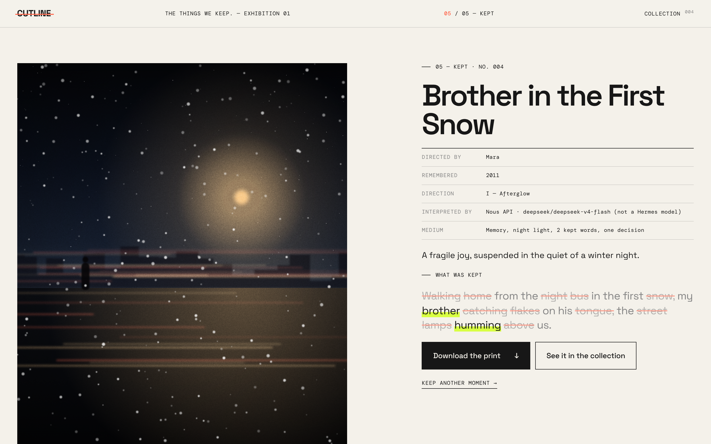
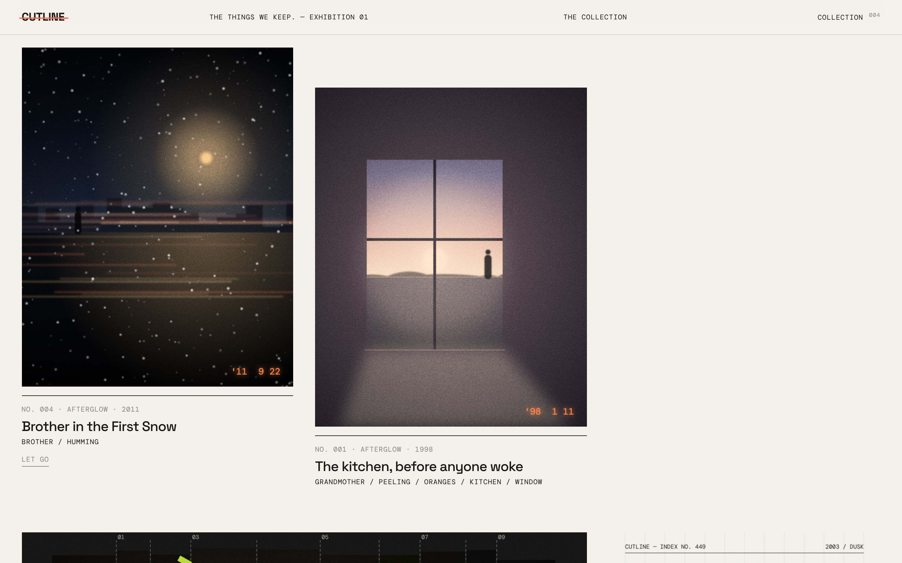

<div align="center">

<br>

# CUTLINE

### THE THINGS WE KEEP.

*Share one ordinary memory. See it read three ways. Decide what stays.*

<br>


<br>

> **When anything can be generated, what matters is what we choose to keep.**

</div>

<br>

---

## The idea

We remember the ordinary moments best: a table, a window, a drive home. They are also the ones
nobody photographed.

Generative tools can make an endless supply of images from such a memory. CUTLINE starts from the
opposite assumption: an image is cheap, and **the decision about what to keep is the human part**.

A visitor writes one ordinary memory. An agent reads it and proposes three different artistic
interpretations. The visitor then acts as creative director: cutting words, cropping, moving the
light. Only what they keep enters the final work. The leftover words remain visible, struck through,
on the wall label.

*Cutline* is the caption under a press photograph. Here it is also the line where you cut.

<br>

## The experience

**Memory → Reading → Directions → Studio → Kept → Collection**

<table>
<tr>
<td width="50%"></td>
<td width="50%"></td>
</tr>
<tr>
<td><sub><b>01 — Memory.</b> One ordinary moment, a year and a name. At least five words.</sub></td>
<td><sub><b>02 — Reading.</b> The words appear as they are read; the screen waits for the interpretation.</sub></td>
</tr>
</table>


<sub><b>03 — Directions.</b> The working title and every direction are written by the model. The label states exactly which model produced them.</sub>

<br><br>


<sub><b>Three directions, one memory.</b> Each plate is rendered live from the model's suggestions for light, motifs and kept words.</sub>

<br><br>


<sub><b>04 — Studio.</b> You are the creative director.</sub>

<br><br>


<sub><b>05 — Kept.</b> A museum wall label. The memory is printed with the cut words struck through in vermilion. The work downloads as a PNG print.</sub>

<br><br>


<sub><b>06 — Collection.</b> Every kept work, re-rendered from the decisions that made it.</sub>

<br>

## Three artistic directions

| | Direction | Visual language |
|---|---|---|
| **I** | **Afterglow** | *An imagined photograph.* A single frame of light and atmosphere: sky gradient, a light source, horizon, film grain, vignette and an orange date stamp. Motifs come from the memory: a window seen from inside, water with a glitter path, motion streaks, rain, snow, small figures. |
| **II** | **Index** | *A typographic inventory.* A Swiss twelve-column grid. The photograph becomes an inset, the kept words are numbered like an archive, and one word becomes an oversized headline, deliberately cropped by the edge. |
| **III** | **Cut** | *A fragment collage.* The photograph is cut into strips and reassembled slightly out of order, the way memory returns. Dashed cut lines, one tinted strip, and the kept words on taped paper labels. |

Every artwork is generated on canvas in the browser and is deterministic: the same memory and the
same decisions always produce the same image. That is why the collection can store decisions
instead of images.

## The studio

| Control | What it changes |
|---|---|
| **What you keep** | Tap words in your own memory to keep or cut them. Kept words drive the caption, the Index list and the Cut labels, and decide which motifs appear in the image. |
| **Direction** | Switch between Afterglow, Index and Cut. |
| **Crop** | 4:5, 1:1, 16:9 or 3:1. |
| **Light** | Dawn, day, dusk or night. Choosing a direction applies its suggested light; the light read from the text is marked `read`. |
| **Grain** | Film grain intensity. |
| **Accent** | Vermilion, lime or none. |
| **Drag on the image** | Moves the light source and the horizon. |
| **Another take** | A new variation of the same decisions. |

## How it works

```
Browser (React + Canvas)                Node server (Express)              Interpreter
────────────────────────               ─────────────────────               ───────────
Memory ──POST /api/interpret──────▶     validate input       ──spawn──▶   Hermes Agent  (hermes -z)
                                        build curator prompt               or the Nous API
Directions ◀── 3 validated directions ◀ parse + repair JSON  ◀───────────
                                        strict validation
          ◀── on any failure: local deterministic interpreter, labelled as such
Studio → Kept → Collection (localStorage) → PNG print
```

- **Frontend and rendering.** Vite, React and TypeScript. All three directions are drawn with the
  Canvas 2D API (`src/lib/render.ts`), at screen resolution for the studio and at print resolution
  for the PNG export.
- **Hermes Agent integration.** With `INTERPRETER=hermes-agent`, the server runs the locally
  installed Nous Research Hermes Agent CLI in one-shot mode (`hermes -z`), signed in through Nous
  Portal (`server/hermesAgent.js`). The served model is read from the agent's usage report and shown
  in the interface.
- **Structured interpretation.** The agent is asked for exactly three directions, one per rendering
  mode, each with: title, emotional interpretation, visual philosophy, composition, light, motifs,
  kept words, what it preserves and what it leaves out. It is told to use only what the visitor
  wrote and to present interpretation as interpretation.
- **Validation** (`server/validate.js`). Exactly three directions, three distinct modes and titles,
  light and motifs from fixed vocabularies, and kept words that must appear in the memory. Common
  JSON mistakes are repaired without adding content. If the output is still invalid, the agent is
  asked once more and told what was wrong.
- **Safety.** Visitor text is untrusted, and the agent's one-shot mode auto-approves tools. The
  server therefore launches the binary without a shell and with the most restricted toolset
  (`-t todo`: no files, terminal, web or browser). It skips rules injection, runs in an empty
  temporary folder, has a timeout, and fences the memory as data.
- **Fallback.** If the interpreter is unavailable or returns invalid data, the original deterministic
  local interpreter is used, and the interface says so: *Local interpreter · Hermes unavailable*. A
  local result is never shown as AI.
- **Honest status.** `GET /api/status` reports what is configured and the outcome of the last real
  run. It never returns secret values.
- **Collection and export.** Kept works are stored in the browser's localStorage as decisions and
  re-rendered on load. Prints are rendered at up to 3000 px wide, with the caption, and saved as PNG.

## Technology and sponsor tools

| Technology | Role in CUTLINE | Where | Status |
|---|---|---|---|
| **Hermes Agent** (Nous Research) | Reads the memory and writes the three creative directions | `server/hermesAgent.js` | **Integrated.** Verified on the demo machine: a real run returned three valid directions in about 15 s that changed the artwork. |
| **Nous Portal** | Sign-in and inference provider for Hermes Agent | `hermes portal` | **Integrated** |
| **Nous inference API** | Alternative interpreter path (OpenAI-compatible chat completions with a server-side key) | `server/nous.js` | **Integrated.** Verified with a real authenticated request. |
| Anthropic `claude-sonnet-5.5` | The model Hermes Agent ran on in the verified demo, chosen in Nous Portal | via Hermes Agent | **Used.** Labelled in the UI as *not a Hermes model* |
| Hermes 4 models | — | — | **Not available.** `Hermes-4-405B` and `Hermes-4-70B` return "This model has been retired" via both the API key and Portal OAuth. |
| React, Vite, TypeScript | Interface | `src/` | Integrated |
| Canvas 2D API | Generative rendering and PNG prints | `src/lib/render.ts` | Integrated |
| Node.js, Express | Server and API | `server/` | Integrated |
| Space Grotesk, DM Mono (Google Fonts) | Typography | `index.html` | Integrated |
| Playwright | End-to-end checks and the screenshots in this README | development only | Used during development |
| Claude Code | Pair-programming during the hackathon | development only | Used during development |

Reducto, Pangram and Modal are **not** integrated in this build.

## Run locally

Requires Node.js 20 or newer.

```bash
npm install
cp .env.example .env          # Windows PowerShell: Copy-Item .env.example .env
npm run dev                   # API on :8787, app on http://localhost:5173
```

Without any interpreter configured, the app runs fully on the local fallback and says so.

**With Hermes Agent** (Windows PowerShell; run one line at a time):

```powershell
iex (irm https://hermes-agent.nousresearch.com/install.ps1)
hermes portal
hermes -z "Reply with exactly: OK" -t todo
Set-Content -Path .env -Encoding ascii -Value "INTERPRETER=hermes-agent","HERMES_AGENT_PROVIDER=nous","HERMES_AGENT_TOOLSETS=todo","HERMES_AGENT_MODEL=","PORT=8787"
npm run dev
```

- `hermes portal` signs you in to Nous Portal in the browser.
- The `hermes -z` line should answer `OK`.

**With the Nous API instead:** set `NOUS_API_KEY` (and `NOUS_MODEL`) in `.env`. Keys live only on the
server, are git-ignored and are never prefixed with `VITE_`. See `.env.example`.

Other commands:
- `npm test` runs the server tests. They need no key: they use a fake Nous server and a fake
  `hermes` binary.
- `npm run build` type-checks and builds the app.
- `npm start` serves the build and the API on one port.

## Structure

```
src/lib/analyze.ts      local deterministic interpreter (fallback)
src/lib/render.ts       Afterglow, Index, Cut and the print renderer
src/lib/interpret.ts    browser client for /api/interpret, source labels
src/components/         one component per stage
server/app.js           /api/status, /api/interpret
server/hermesAgent.js   Hermes Agent adapter (hermes -z)
server/nous.js          Nous API client
server/validate.js      JSON repair and strict validation
docs/images/            screenshots of the running app
```

## Notes on the screenshots

All screenshots are unedited captures of the running application at 1440 × 900 (2× pixel density).
They were taken in the development environment, where the interpreter was the Nous API with
`deepseek/deepseek-v4-flash`. The interface therefore reads *Interpreted by Nous API ·
deepseek/deepseek-v4-flash (not a Hermes model)*. On the demo machine, the same screen reads
*Interpreted by Hermes Agent · anthropic/claude-sonnet-5.5 (not a Hermes model)*.

---

<div align="center">

**CUTLINE** — an exhibition piece for *The Things We Keep.*

Concept, direction and product by the CUTLINE team. Built during the hackathon with
Hermes Agent by Nous Research.

<sub>Typography: Space Grotesk and DM Mono. Palette: ivory #F4F1EA, charcoal #171717, grey #858585, vermilion #FF674D, lime #D8FF42.</sub>

</div>
