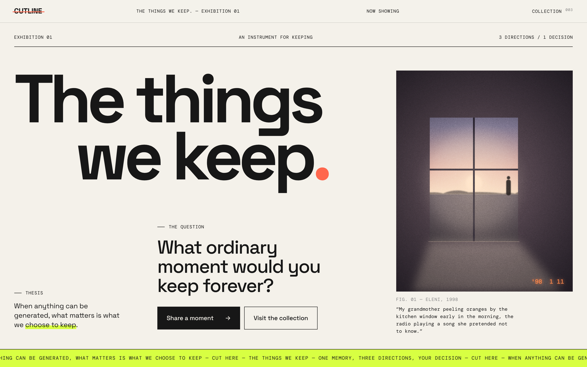
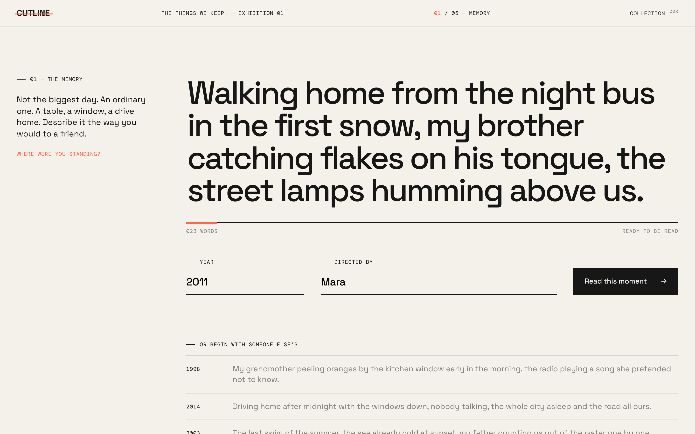
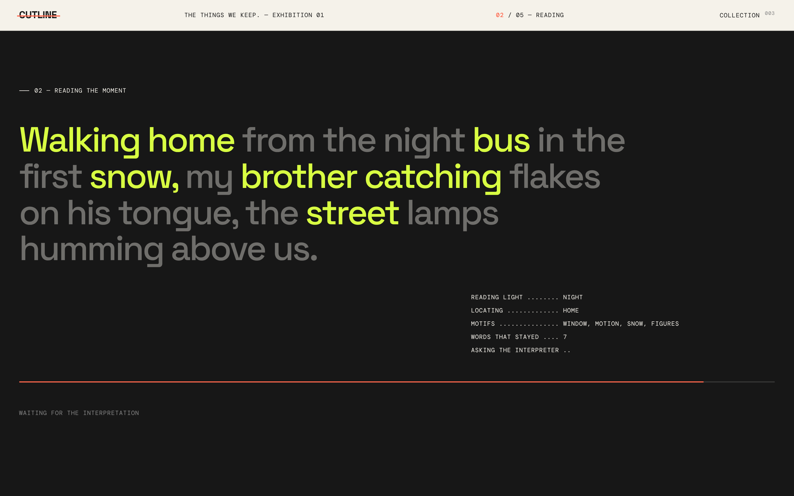
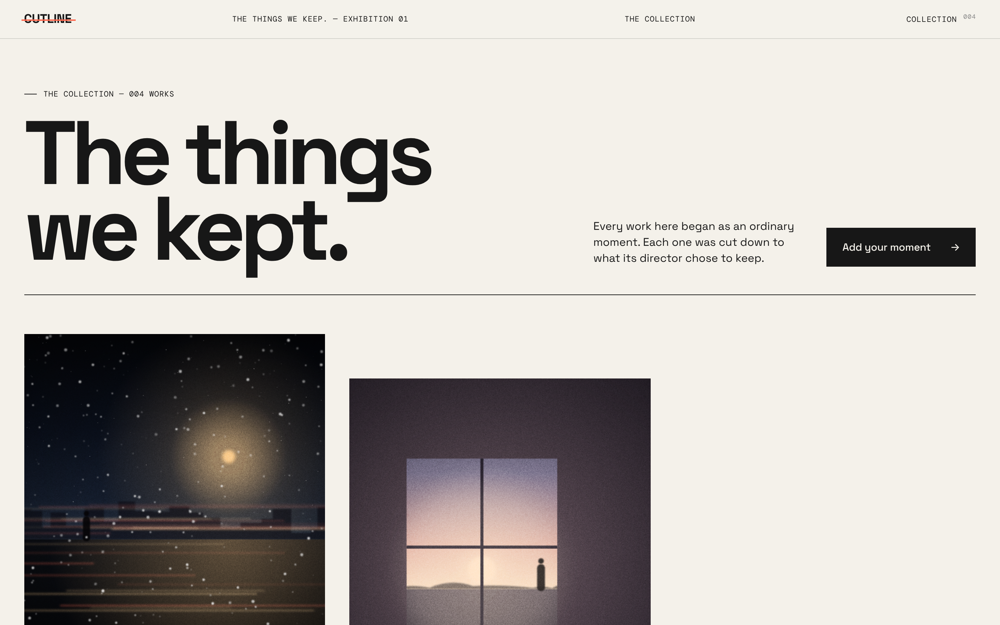
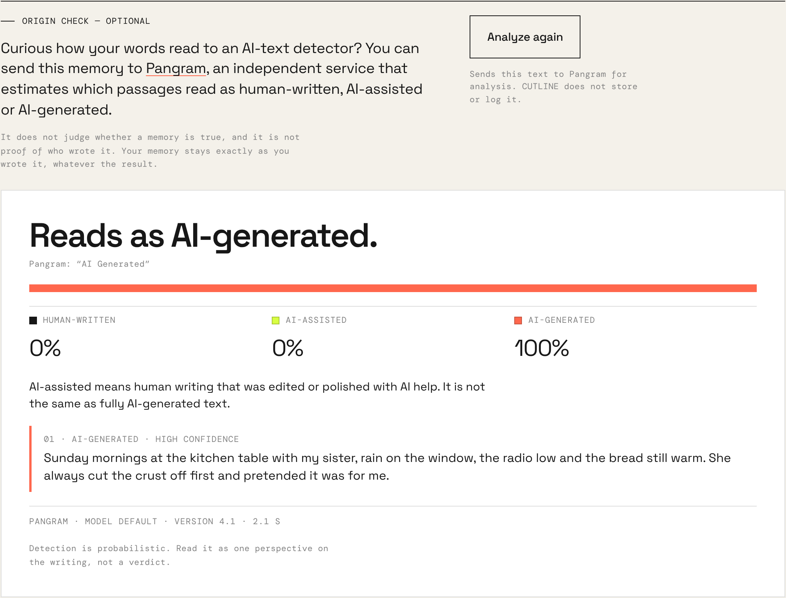
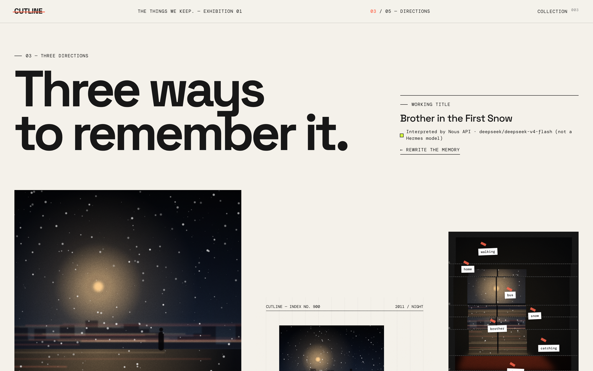

<div align="center">

<br>

# CUTLINE

### THE THINGS WE KEEP.

An exhibition piece in which one ordinary memory is read three ways by an AI agent,<br>
and a person decides what remains.

<br>



<br><br>

**When anything can be generated, what matters is what we choose to keep.**

<br>

<sub>
<a href="#the-idea">The idea</a> &nbsp;·&nbsp;
<a href="#the-experience">The experience</a> &nbsp;·&nbsp;
<a href="#origin-check">Origin check</a> &nbsp;·&nbsp;
<a href="#how-ai-is-used">How AI is used</a> &nbsp;·&nbsp;
<a href="#photograph-on-modal">Photograph</a> &nbsp;·&nbsp;
<a href="#status">Status</a> &nbsp;·&nbsp;
<a href="#technology-and-sponsors">Technology</a> &nbsp;·&nbsp;
<a href="#run-locally">Run locally</a>
</sub>

</div>

<br>

<table>
<tr>
<td width="33%" valign="top"><b>AI proposes.</b><br><sub>Hermes Agent reads the memory and writes three distinct artistic directions, each with its own light, motifs and words to keep.</sub></td>
<td width="33%" valign="top"><b>You decide.</b><br><sub>In the studio you cut words, crop, relight and move the horizon. Nothing enters the work without your choice.</sub></td>
<td width="33%" valign="top"><b>Only what you keep remains.</b><br><sub>The work is kept with a wall label and the memory printed with every cut word struck through.</sub></td>
</tr>
</table>

<br>

## The idea

The moments we remember best are rarely the ones anybody photographed: a table, a window, a drive
home.

An image of such a moment can now be produced in seconds, endlessly. CUTLINE starts from what
remains scarce: **deciding what to keep.** The machine is asked for possibilities, not for an
answer. The person stays the editor.

A *cutline* is the caption under a press photograph. In CUTLINE it is also the line where you cut.

<br>

## The experience

**Memory → Reading → Directions → Studio → Kept → Collection**

<br>

<table>
<tr>
<td width="50%" valign="top"></td>
<td width="50%" valign="top"></td>
</tr>
<tr>
<td valign="top"><b>01 · Memory</b><br><sub>One ordinary moment, written the way you would tell a friend, with a year and a name. Rotating prompts help: <i>What was the light like? What sound do you still hear?</i> An optional <a href="#origin-check">Origin check</a> sits on the same screen.</sub></td>
<td valign="top"><b>02 · Reading</b><br><sub>The words appear as they are read. A local reading notes light, place and motifs while the agent is asked. The screen waits for the interpretation before moving on.</sub></td>
</tr>
</table>

<br>


**03 · Directions.** Three plates, each rendered live from what the agent proposed for that direction.
Each carries its own title, an emotional interpretation and curatorial notes: philosophy,
composition, light and motifs, what it keeps and what it leaves out. *Direct this* opens one in the
studio. The screen always names what produced the reading: the agent and its model, or the local interpreter.

<br>


**04 · Studio.** *You are the creative director.* Tap words in your own memory to keep or cut them.
Kept words become the caption, the numbered inventory and the paper labels, and decide which motifs
appear in the image. Switch direction, crop, relight, adjust grain and accent, drag across the image
to move the light and the horizon, or ask for another take. Optionally, develop a
[photograph](#photograph-on-modal) of the direction on a Modal GPU, and choose whether it stays with
the work.

<br>


**05 · Kept.** A museum wall label: title, director, year, direction, the interpreter, and the
medium. The medium line reads *memory, light, kept words, one decision.* Below it is the memory
itself, kept words highlighted and every cut word struck through. *Download the print* saves a PNG
with the work and its caption.

<br>

<table>
<tr>
<td width="50%" valign="top"></td>
<td width="50%" valign="top"></td>
</tr>
</table>

**06 · Collection.** Every kept work is numbered and hung on a wall with its title and cutline.
Works are stored as decisions, not images, and re-rendered on each visit. Three example works open
the collection. Any work can be opened again; your own can be let go.

<br>

## Origin check



<sub>A real Pangram result. The sample memory was written by an AI for testing, and Pangram reads it as AI-generated.</sub>

An exhibition called *The Things We Keep* asks for your own words. **Origin check** lets a visitor ask,
voluntarily, how their memory reads to an AI-text detector before it becomes a work. It uses
[Pangram](https://www.pangram.com)'s REST API.

**What it shows** is only what Pangram returns:
- the overall reading, with Pangram's own headline
- the human-written, AI-assisted and AI-generated fractions
- each segment, with its label and confidence
- the model and version

The panel explains that **AI-assisted** means human writing edited or polished with AI help, which is
different from AI-generated.

**What it is not.** It estimates how text reads. It is not a truth detector and not proof that a memory
is authentic, invented, or written by a particular person. The interface says so before and after the
analysis.

**How it treats the visitor:**
- Nothing is sent until the visitor presses *Analyze with Pangram*, and the screen says beforehand
  where the text goes.
- The memory is never rejected, rewritten or changed because of a result. Editing the text after an
  analysis marks the result as out of date.
- The Pangram key stays on the server. CUTLINE does not write memory text to its logs and does not
  store analysis results.
- Insufficient credits, an invalid key, a model that isn't enabled, rate limits, timeouts and outages
  each get a plain message.

<sub>Server flow: <code>GET /models</code> discovers the models the account may use, <code>POST /task</code> submits the text, and <code>GET /task/{id}</code> is polled until it finishes. Only documented fields are kept, with checked types; unknown values are dropped, never guessed. Each analysis uses Pangram credits.</sub>

<br>

## How AI is used

**Hermes Agent** by Nous Research is CUTLINE's interpreter. The server runs the locally installed
agent in one-shot mode (`hermes -z`), signed in through Nous Portal. It asks for exactly three
directions, one per rendering mode, each with:

> a title · an emotional interpretation · a visual philosophy · a composition · a light · motifs ·
> words from the memory to keep · what it preserves · what it leaves out

**What the agent's answer changes.** The three titles and texts on the directions screen and the wall
label. For each direction, the starting light, the motifs drawn into the image, and the words that
start out kept.

**What it does not do.** It does not draw. Every image is produced by CUTLINE's own canvas renderer.
It never decides the final work: every word, crop and light can be changed by the person.

**Guardrails:**
- *Only what was written.* The agent is told to use only the visitor's words and to present
  interpretation as interpretation.
- *Strict validation.* The server requires three directions, three distinct modes and titles, light
  and motifs from fixed vocabularies, and kept words that actually appear in the memory. Small JSON
  mistakes are repaired without adding content. Otherwise the agent is asked once more and told what
  was wrong.
- *A sandboxed agent.* Visitor text is untrusted, and one-shot mode auto-approves tools. The agent
  therefore runs with the most restricted toolset (`todo`: no files, terminal, web or browser),
  without rules injection, without a shell, in an empty temporary folder, with a timeout.
- *Honest labels.* The interface names the exact model, for example *Hermes Agent ·
  anthropic/claude-sonnet-5.5 (not a Hermes model)*. If the agent is unavailable, a deterministic
  local interpreter takes over and is labelled *Local interpreter*. It is never presented as AI.


<sub>The source is always named. This capture comes from the development environment (Nous API path). On the demo machine the label names Hermes Agent and its model.</sub>

> **On models.** Hermes Agent runs on the model chosen in Nous Portal. Hermes 4 models
> (`Hermes-4-405B`, `Hermes-4-70B`) currently return *"This model has been retired"*, so the
> verified demo ran Hermes Agent on `anthropic/claude-sonnet-5.5`, and the interface says so.

<br>

## Photograph on Modal

The canvas gives every direction an immediate, deterministic image. **Photograph** adds a second,
optional medium: in the studio, *Develop a photograph* sends the chosen direction to a GPU on
[Modal](https://modal.com), and Stable Diffusion XL develops it as a quiet analogue photograph.

- **Built from the direction, not from imagination.** The prompt is assembled on the server from
  the direction's composition, light and motifs and the words the person kept. Nothing else is added
  about their life.
- **Never kept automatically.** The photograph appears beside the canvas work. It joins the work only
  if the person presses *Keep with the work*. They can develop another, or ignore it.
- **A real saved artwork.** A kept photograph is the image shown on the wall label and in the
  collection, with the canvas work beside it as a study. It survives a refresh.
- **Safe by design.** The Modal endpoint requires a key that exists only in a Modal Secret and the
  CUTLINE server's environment. The browser never talks to Modal. Requests are validated on both
  sides, and the GPU shuts down after two idle minutes.

**Storage.** Images are stored by the CUTLINE server in `data/photographs/`, which is git-ignored.
The browser's collection keeps only each photograph's id, so `localStorage` stays small. This is a
local-demo store on one machine, not durable multi-user storage. If a photograph is missing, the
canvas work is shown instead.

| | |
|:--|:--|
| Model | [Stable Diffusion XL base 1.0](https://huggingface.co/stabilityai/stable-diffusion-xl-base-1.0) · CreativeML OpenRAIL++-M licence |
| Service | `modal/cutline_photograph.py` · A10G GPU · 28 steps · JPEG · sizes per crop, e.g. 896 × 1152 for 4:5 |
| Route | `POST /api/photograph` → Modal → `GET /api/photographs/:id` |

<br>

## The three directions

| | Direction | Visual language |
|:--|:--|:--|
| **I** | **Afterglow**<br><sub>imagined photograph</sub> | One frame of light: sky, a light source, horizon, film grain, vignette and an orange date stamp. Motifs come from the kept words: a window seen from inside, water with a path of light, motion streaks, rain, snow, small figures. |
| **II** | **Index**<br><sub>typographic inventory</sub> | A Swiss twelve-column grid. The photograph becomes an inset, kept words are numbered like an archive, and one word becomes an oversized headline, cropped by the edge. |
| **III** | **Cut**<br><sub>fragment collage</sub> | The photograph cut into strips and reassembled slightly out of order, the way memory returns. Dashed cut lines, one tinted strip, kept words on taped paper labels. |

Rendering is deterministic: the same memory and the same decisions always produce the same image.

<br>

## The studio

| Control | |
|:--|:--|
| **What you keep** | Tap any meaningful word in the memory to keep or cut it. At least one word stays. |
| **Direction** | Afterglow, Index or Cut. Switching brings that direction's motifs and keeps your light and words. |
| **Crop** | 4:5 · 1:1 · 16:9 · 3:1 |
| **Light** | Dawn · day · dusk · night. The light read from the text is marked. |
| **Grain** | Film grain, from clean to heavy. |
| **Accent** | Vermilion, lime or none. |
| **Drag on the image** | Moves the light source and the horizon. |
| **Another take** | A new variation of the same decisions. |
| **Photograph** | Optional: develop a photograph of the direction on Modal, then *Keep with the work* or not. |

<br>

## Technology and sponsors

**Integrated in the product**

| | Role in CUTLINE | Where | Verified |
|:--|:--|:--|:--|
| **Hermes Agent** · Nous Research | Interprets the memory and writes the three directions | `server/hermesAgent.js` | A real run on the demo machine (Windows, Hermes Agent v0.23.3): three valid directions in about 15 s that changed the artwork |
| **Nous Portal** | Sign-in and inference provider for Hermes Agent | `hermes portal` | Signed in through OAuth on the demo machine |
| **Pangram** | Origin check: optional AI-text analysis of the memory | `server/pangram.js` · `src/components/OriginCheck.tsx` | Real analyses through the app: models `default`, `pangram-4`, `pangram-4.1` discovered; version 4.1, about 2 s per analysis |
| **Nous inference API** | Alternative interpreter path (server-side key) | `server/nous.js` | A real authenticated request returning three valid directions |
| **Modal** | Photograph: GPU image generation from the chosen direction | `modal/cutline_photograph.py` · `server/photograph.js` | Deployed; the live endpoint's key check is verified. The app flow is tested against a stand-in endpoint. **A real SDXL generation through CUTLINE is not yet confirmed**; see [Status](#status). |

**Built with:** React 19, Vite, TypeScript, the Canvas 2D API, Node.js, Express, Space Grotesk and
DM Mono.

**Explored, not integrated**

| | |
|:--|:--|
| Hermes 4 models | Retired on Nous Portal and the Nous API at the time of building; see *On models* above. |
| Pangram MCP | Evaluated. It gives tools to an AI assistant through OAuth, not to a web server, so the product uses Pangram's REST API. |
| Reducto | Not integrated. A possible next step: reading a scanned letter or diary page as the memory. |

**Used during development:** Claude Code (pair programming) and Playwright (browser checks and the
screenshots in this README).

<br>

## Architecture

```
Browser · React + Canvas                 Server · Node + Express                 Services
────────────────────────                 ───────────────────────                 ────────
Memory ── POST /api/interpret ───────▶   validate input, curator prompt ──────▶  Hermes Agent  (hermes -z)
Directions ◀── 3 validated directions ── repair + strict validation   ◀───────    or Nous API
        └─ on any failure: local deterministic interpreter, labelled

Memory ── POST /api/origin (optional) ─▶ models, submit, poll, normalise ────▶   Pangram REST API

Studio ── POST /api/photograph (opt.) ─▶ prompt from direction, store JPEG ───▶  Modal · SDXL on A10G
       ◀─ GET /api/photographs/:id ───── data/photographs/<id>.jpg

Studio → Kept → Collection (localStorage) → PNG print            GET /api/status: configuration
                                                                  and last real outcomes, no secrets
```

| Path | |
|:--|:--|
| `src/lib/render.ts` | Afterglow, Index, Cut and the print renderer |
| `src/lib/analyze.ts` | Local deterministic interpreter (fallback) |
| `src/lib/interpret.ts` · `src/lib/origin.ts` | Browser clients for `/api/interpret` and `/api/origin` |
| `src/components/` | One component per stage, plus `OriginCheck` |
| `server/app.js` | Routes: `/api/status`, `/api/interpret`, `/api/origin` |
| `server/hermesAgent.js` · `server/nous.js` | Interpreters |
| `server/validate.js` | JSON repair and validation of directions |
| `server/pangram.js` | Origin check client |
| `server/photograph.js` · `modal/cutline_photograph.py` | Photograph: server client and the Modal GPU service |
| `src/components/PhotographPanel.tsx` · `WorkImage.tsx` | Photograph in the studio; kept photographs on the wall |

<br>

## Run locally

Node.js 20 or newer. Windows PowerShell shown; on macOS or Linux use `cp` instead of `Copy-Item`.

```powershell
npm install
Copy-Item .env.example .env
npm run dev
```

Open **http://localhost:5173**. The API runs on port 8787, and Vite forwards `/api` to it. With no
services configured, the whole journey works on the local interpreter and says so. The server's
startup lines show which services it found, without printing any values.

For a single-port demo build:

```powershell
npm run build
npm start
```

Then open **http://localhost:8787**.

**Services (all optional), configured in `.env`:**

| | Setup | `.env` |
|:--|:--|:--|
| **Hermes Agent** | `iex (irm https://hermes-agent.nousresearch.com/install.ps1)`, then `hermes portal`, then check `hermes -z "Reply with exactly: OK" -t todo` | `INTERPRETER=hermes-agent` · `HERMES_AGENT_PROVIDER=nous` · `HERMES_AGENT_TOOLSETS=todo` |
| **Pangram** | An API key from your Pangram account | `PANGRAM_API_KEY` · optional `PANGRAM_MODEL` |
| **Modal** | `modal setup`; a Secret `cutline-image-key` holding `CUTLINE_IMAGE_KEY`; `modal deploy modal/cutline_photograph.py` | `MODAL_PHOTOGRAPH_URL` (the printed `.modal.run` URL) · `MODAL_PHOTOGRAPH_KEY` (the same value as the Secret) |
| **Nous API** *(instead of Hermes Agent)* | An API key | `NOUS_API_KEY` · `NOUS_MODEL` |

Keys live only in `.env` on the server. The file is git-ignored, keys are never prefixed with
`VITE_`, and `.env.example` contains placeholders only.

<br>

## Demo in three minutes

1. **Memory.** Write a real memory of your own, or pick one of the examples. Optionally press
   *Analyze with Pangram* and read the origin estimate.
2. **Reading → Directions.** The agent reads it. Point out the three titles, the curatorial notes and
   the label that names the model.
3. **Studio.** Choose a direction. Cut a word and watch the image change, drag the light, then
   *Develop a photograph* on Modal.
4. **Kept.** Decide whether the photograph stays with the work, then press *Keep this*. Show the wall
   label with the struck-through words and download the print.
5. **Collection.** Refresh the page. The work is still there.

<br>

## Status

| | |
|:--|:--|
| ✓ **Verified with real services** | Hermes Agent interpretation (demo machine) · Nous API interpretation · Pangram Origin check (real analyses, real insufficient-credits error) |
| ✓ **Verified in the browser** | Every screen and studio control, PNG print, collection persistence after refresh, production build on one port |
| ◐ **Deployed, real generation not yet verified** | Photograph on Modal. `modal/cutline_photograph.py` is deployed, and the live endpoint rejects requests without the key or with a wrong key (`401`). The whole CUTLINE flow (develop → studio → keep → collection after refresh) passes against a stand-in endpoint. The first authenticated SDXL generation through CUTLINE has not yet been confirmed. |
| ○ **Not integrated** | Reducto |

<br>

### Known limitations

- **Photographs** are stored on the local server's disk (`data/photographs/`). This suits a single
  demo machine, not shared or durable hosting.
- The **collection** lives in the browser's `localStorage`, per browser and per device.
- **Hermes Agent** runs where it is installed, signed in through Nous Portal. Hermes 4 models are
  currently retired, so the agent runs on the model chosen in Portal, and the interface names it.
- **Origin check** is a probabilistic estimate from Pangram, never proof of authorship, and each
  analysis uses Pangram credits.
- The first **photograph** after a pause waits for a GPU to start, which can take a minute or more.

<br>

## Testing

```powershell
npm test
```

27 server tests, all passing. They need no keys or credits: they run against a fake Nous server, a
fake Pangram server, a fake Modal endpoint and a fake `hermes` binary.

| | Tests | Covers |
|:--|:--:|:--|
| Interpretation and validation | 8 | ordering, rejection of malformed directions, JSON extraction, status without secrets, key redaction, input limits |
| Hermes Agent | 6 | restricted toolset and empty folder, honest status, fallback on failure, JSON repair, one corrective retry |
| Origin check | 7 | model discovery, submit and poll, documented fields only, credits and rate-limit errors, model selection, input limits |
| Photograph | 6 | generate, store and serve; key never exposed; wrong key, Modal down and non-image responses; input validation; safe ids; prompt from the direction only |

Beyond the automated tests, these were verified by hand with real services:
- Hermes Agent on the demo machine
- the Nous API
- Pangram, including the insufficient-credits case before credits were added

The browser journey (every screen, studio control, PNG export, collection persistence, and the
photograph flow against a stand-in endpoint) was checked with Playwright during development. Those
scripts are not part of the repository.

<br>

## About the screenshots

All screenshots are unedited captures of the running application at 1440 × 900 (2× density). They
were taken in the development environment, where the interpreter was the Nous API with
`deepseek/deepseek-v4-flash`, so labels read *Nous API · deepseek/deepseek-v4-flash (not a Hermes
model)*. On the demo machine the same label reads *Hermes Agent · anthropic/claude-sonnet-5.5 (not a
Hermes model)*. The Origin check result is a real Pangram response. Names in the screenshots are
samples.

<br>

---

<div align="center">

<br>

**CUTLINE**<br>
<sub>an exhibition piece for <i>The Things We Keep.</i></sub>

<br>

<sub>Concept, direction and product by the CUTLINE team.<br>
Built during the hackathon with Hermes Agent by Nous Research and Pangram,<br>
with a photograph service for Modal.</sub>

<br>

<sub>Space Grotesk · DM Mono — ivory #F4F1EA · charcoal #171717 · grey #858585 · vermilion #FF674D · lime #D8FF42</sub>

<br><br>

</div>
